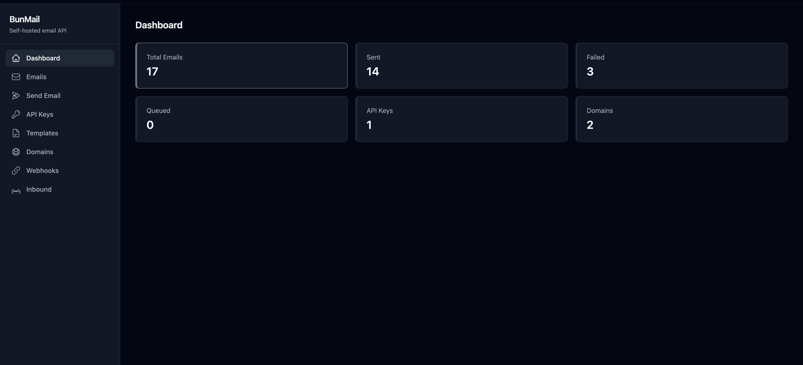
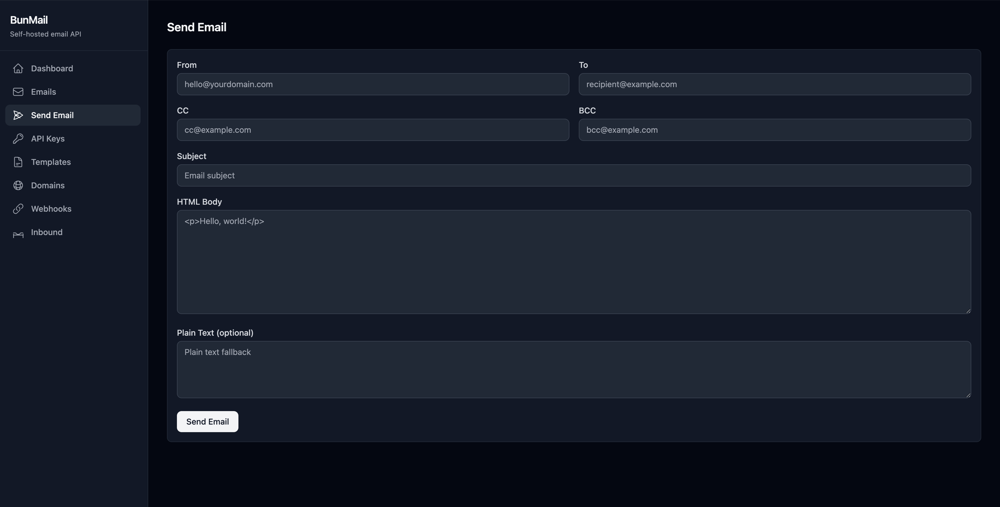
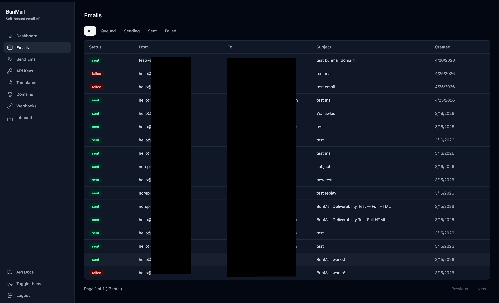
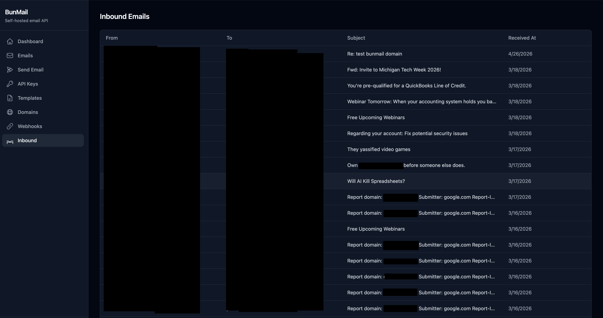
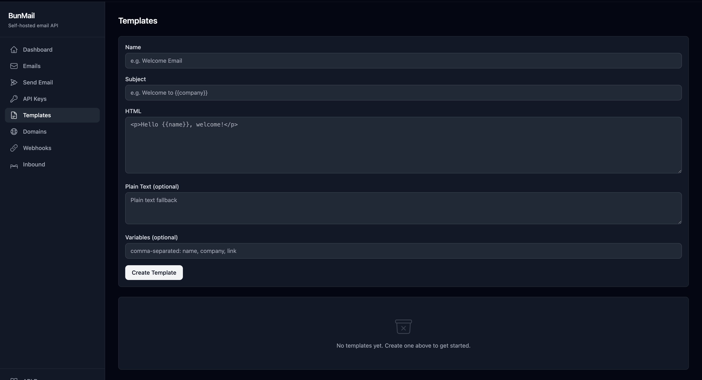
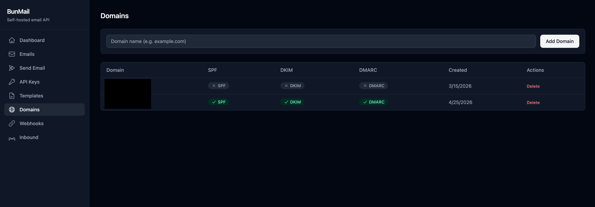
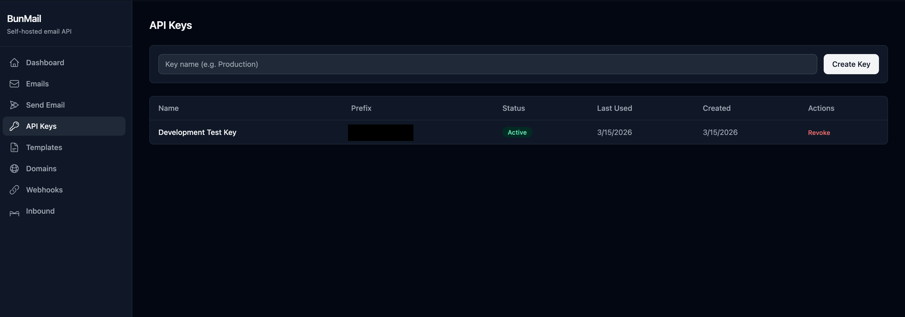

# BunMail

[](https://github.com/mohamedboukari/bunmail/actions/workflows/ci.yml)
[](https://github.com/mohamedboukari/bunmail/actions/workflows/codeql.yml)
[](LICENSE)
[](https://bun.sh)
[](https://elysiajs.com)
[](https://orm.drizzle.team)
[](https://www.postgresql.org)

> **Send transactional email from your own server.** No subscriptions. No per-email pricing. No vendor lock-in.

A self-hosted alternative to SendGrid, Resend, and Postmark: built in TypeScript on Bun + Elysia, with a REST API, web dashboard, DKIM signing, an email queue with retries, webhooks, templates, inbound SMTP, and Gmail-style trash. Ships in a single Docker container.

## Why BunMail?

| | BunMail | SendGrid / Resend | Postal | Mailcow |
|---|---|---|---|---|
| **Self-hosted** | ✅ | ❌ | ✅ | ✅ |
| **Free** | ✅ MIT | $20/mo+ | ✅ MIT | ✅ |
| **API-first** | ✅ | ✅ | ✅ | ❌ (mail hosting) |
| **One container** | ✅ | n/a | ❌ (multiple services) | ❌ (heavy stack) |
| **Modern stack** | Bun + Elysia + Drizzle | n/a | Ruby + RabbitMQ | PHP + many services |
| **Web dashboard** | ✅ | ✅ | ✅ | ✅ |
| **Templates** | ✅ | ✅ | ❌ | ❌ |
| **Inbound SMTP** | ✅ | $$ | ✅ | ✅ |

BunMail targets developers who want a **programmatic transactional email API** and nothing else: Postal is heavier, Mailcow targets full mail-server hosting with end-user webmail, and the SaaS options charge per email.

## Quick Start (60 seconds)

```bash
git clone https://github.com/mohamedboukari/bunmail.git && cd bunmail
cp .env.example .env
# docker compose runs BunMail in production mode, which refuses to start
# without these. Later lines in .env win over the template's defaults.
cat >> .env <<EOF
POSTGRES_PASSWORD=$(openssl rand -hex 16)
DKIM_ENCRYPTION_KEY=$(openssl rand -base64 32)
MAIL_HOSTNAME=mail.yourcompany.com
BUNMAIL_OWNER_EMAIL=you@yourcompany.com
EOF
docker compose up -d
```

Replace `mail.yourcompany.com` with this server's real hostname (placeholders such as `*.example.com` are refused) and `you@yourcompany.com` with your email: it becomes the dashboard login. The app listens on `127.0.0.1:3000` only: reach it from outside through a reverse proxy with TLS ([docs/self-hosting.md](docs/self-hosting.md), section 6); host-specific ports such as inbound SMTP go in a `docker-compose.override.yml` copied from `docker-compose.override.example.yml`.

Then seed your first API key and send a test email:

```bash
docker compose exec app bun run src/db/seed.ts
# copy the bm_live_... key it prints

curl -X POST http://localhost:3000/api/v1/emails/send \
  -H "Authorization: Bearer bm_live_YOUR_KEY" \
  -H "Content-Type: application/json" \
  -d '{
    "from": "hello@yourdomain.com",
    "to": "user@example.com",
    "subject": "Hello from BunMail",
    "html": "<p>It works.</p>"
  }'
```

In production mode the `from` domain must first be registered (see [docs/self-hosting.md](docs/self-hosting.md#register-your-domain-generates-dkim-keys)), otherwise the send is rejected with `422 SENDER_DOMAIN_NOT_REGISTERED`. Publish and verify its DKIM, SPF and DMARC records before sending real mail: until then the response lists `warnings` such as `dkim_unverified`, and `REQUIRE_VERIFIED_DOMAIN=true` refuses the send instead.

To open the dashboard, claim the owner account: on first boot BunMail logs a one-time setup link (`docker compose logs app | grep 'Owner setup link'`). Open it, choose a password (15 characters or more), and you are signed in at <http://localhost:3000/dashboard>. After that, sign in with `BUNMAIL_OWNER_EMAIL` and that password. Lost the link? `docker compose exec app bun run src/db/reset-owner.ts` prints a new one.

> Local dev without Docker? See [docs/self-hosting.md](docs/self-hosting.md).

## Will my mail land in inbox?

**Honest answer: it depends on your sending setup, not on BunMail.** Self-hosted transactional email is a reputation problem, not a code problem.

- ✅ **You'll land in inbox** if you send from a domain with a clean reputation, your server's IP isn't on a blacklist, and you've published correct SPF / DKIM / DMARC records (BunMail signs with DKIM, lists the records to publish and checks SPF, DKIM and DMARC for each domain; you publish them at your DNS provider, see [docs/self-hosting.md](docs/self-hosting.md)).
- ⚠️ **You'll likely land in spam** if you send from a brand-new `.xyz`/`.top`-style domain on a fresh budget VPS IP. That's not a BunMail bug: Gmail and Outlook penalise both factors heavily for any sender.
- 🛠️ **What helps:** warm up the domain and IP over 2 to 3 weeks (low volume, real recipients who open and reply), set the reverse DNS of your IP to `MAIL_HOSTNAME`, and keep the dashboard's checks green: the Server identity card (reverse DNS), the Blocklists card (DNSBL listings of your sending IP) and each domain's SPF, DKIM and DMARC status. BunMail always delivers directly; it does not hand mail to a third-party provider.

Run [mail-tester.com](https://www.mail-tester.com) to get a deliverability score for your specific setup before deploying.

## Screenshots



<table>
  <tr>
    <td><a href="public/Send-Email.png"></a></td>
    <td><a href="public/Emails.png"></a></td>
  </tr>
  <tr>
    <td><a href="public/Inbound.png"></a></td>
    <td><a href="public/Templates.png"></a></td>
  </tr>
  <tr>
    <td><a href="public/Domains.png"></a></td>
    <td><a href="public/API-Keys.png"></a></td>
  </tr>
</table>

## Features

- **Direct SMTP delivery**: sends straight to recipient MX servers, failing over across MX hosts (and to the implicit MX), no relay needed; honours recipient domains' MTA-STS policies (verified TLS to the MX hosts they name, in enforce mode); throttled per provider (Microsoft, Google, Yahoo, Apple, or the MX's registrable domain), with an optional per-provider message rate
- **SMTP submission**: apps (Infisical, Netbird, Dify, any Nodemailer backend) send *through* BunMail over SMTP using an API key as the password; switch an app off SendGrid/Brevo with a credentials-only change ([docs/smtp-submission.md](docs/smtp-submission.md))
- **DKIM signing**: auto-generates 2048-bit RSA keys per domain, under a selector you can choose, with zero-downtime key rotation
- **SPF / DKIM / DMARC verification**: DNS checks built into the dashboard, with the records to publish per domain, the parsed DMARC policy and where the MX points, re-run daily in the background so a record that drifts is caught (`domain.verification_failed`)
- **Email queue**: Postgres-backed with MTA-style retry backoff (up to 48 h for temporary failures such as greylisting), lease-based crash recovery that is safe with several replicas, and no double sends between concurrent workers
- **Idempotency keys**: an optional `Idempotency-Key` header on the send API makes retries safe; a repeat with the same key and body returns the first response instead of sending twice, even under concurrent retries ([docs/api.md](docs/api.md#post-apiv1emailssend))
- **Templates**: Mustache-style `{{variable}}` substitution, HTML-escaped in the HTML body (`{{{variable}}}` inserts raw HTML)
- **Webhooks**: HMAC-signed events with timestamp-bound replay protection: `email.queued`, `email.sent`, `email.failed`, `email.bounced`, `email.complained` (feedback-loop spam complaints, #191), `email.received`, `email.unsubscribed`, `domain.verification_failed`, `domain.verified`
- **Inbound SMTP**: receive and store incoming mail with DNSBL, recipient validation, and per-IP rate limiting; reply from the dashboard with RFC 5322 threading headers, and see which of your emails a received reply answers
- **Inbound notifications**: per-domain "you have new mail" email on receive, DKIM-signed from the recipient domain, with no content of the inbound message by default, automatic mail skipped and per-address and per-domain throttles; opt-in via each domain's `notify_email`
- **API key auth**: SHA-256 hashed Bearer tokens with per-key rate limiting
- **Trash + auto-purge**: Gmail-style soft delete on outbound and inbound, restorable until purged after `TRASH_RETENTION_DAYS` (default 7)
- **Suppression list**: per-API-key list of addresses we refuse to send to; gate runs at `POST /emails/send` so bounced/unsubscribed recipients can't re-tank IP reputation; a mailbox still full (`4.2.2`) when retries run out is suppressed for 24 h, and `SUPPRESSIONS_SHARED_HARD=true` also refuses addresses any key hard-bounced on or got a complaint for
- **Sender display name and send category**: an optional `fromName` (checked so it cannot pose as an address) and `category` (`transactional` mail goes out without `List-Unsubscribe`, `marketing` mail is refused unless it can carry the one-click link); HTML-only mail gets a derived text part and fragments a document wrapper at send time
- **One-click unsubscribe**: single-recipient mail carries a per-recipient RFC 8058 `List-Unsubscribe` link (and an `unsub+` mailto when inbound SMTP is on); using it suppresses that recipient for the sending key and fires `email.unsubscribed` ([docs/suppressions.md](docs/suppressions.md#one-click-unsubscribe))
- **DMARC aggregate report ingest**: daily `rua` reports from Microsoft / Google / Yahoo are auto-parsed (gzip / zip / raw XML) and surfaced in the dashboard so misaligned source IPs are visible at a glance
- **Web dashboard**: server-rendered (Elysia JSX), bulk operations, real-time stats (24h sent, success rate, bounce rate with a warning above 2%, queue depth), a per-MX delivery table on each email with a badge for sessions sent without TLS; owner account login with revocable server-side sessions, invite-only teammate accounts (admin or member), a Users page to change roles, deactivate or remove accounts, issue one-time password reset links and transfer ownership, a Change password page for every account (signs out every other device), an Active sessions page for every account (device, IP, optional approximate location from an offline GeoIP database; sign out one device or all others), an email alert on sign-in from a new device (no links), optional TOTP two-factor authentication with recovery codes for every account (`REQUIRE_2FA` makes it mandatory for the owner or admins), an append-only audit log of security-relevant actions (sign-ins, account, two-factor, API key, domain, webhook and suppression changes, with actor, IP and user agent) for admins, and per-user API keys (members manage their own restricted keys; deactivating an account disables its keys)
- **OpenAPI 3.0**: interactive docs at `/api/docs`
- **Type-safe**: strict TypeScript, Drizzle ORM, no `any`

## API Endpoints

All endpoints (except `/health` and the public unsubscribe pages at `/u/:token`) require `Authorization: Bearer <api-key>`. Full reference: [docs/api.md](docs/api.md).

### Emails

| Method | Path | Description |
|--------|------|-------------|
| POST | `/api/v1/emails/send` | Queue an email (direct or template) |
| GET | `/api/v1/emails` | List emails (excludes trash) |
| GET | `/api/v1/emails/trash` | List trashed emails |
| GET | `/api/v1/emails/:id` | Get email by ID |
| DELETE | `/api/v1/emails/:id` | Move to trash |
| POST | `/api/v1/emails/bulk-delete` | Bulk move to trash |
| POST | `/api/v1/emails/:id/restore` | Restore from trash |
| DELETE | `/api/v1/emails/:id/permanent` | Permanently delete a trashed email |
| POST | `/api/v1/emails/trash/empty` | Empty trash |
| GET | `/api/v1/emails/tombstones` | List post-purge audit snapshots (optional `?messageId=`) |
| GET | `/api/v1/emails/tombstones/:id` | Get a tombstone by the original email ID |

### Inbound

| Method | Path | Description |
|--------|------|-------------|
| GET | `/api/v1/inbound` | List received emails |
| GET | `/api/v1/inbound/trash` | List trashed inbound |
| GET | `/api/v1/inbound/:id` | Get inbound email by ID |
| DELETE | `/api/v1/inbound/:id` | Move to trash |
| POST | `/api/v1/inbound/bulk-delete` | Bulk move to trash |
| POST | `/api/v1/inbound/:id/restore` | Restore from trash |
| DELETE | `/api/v1/inbound/:id/permanent` | Permanently delete a trashed inbound |
| POST | `/api/v1/inbound/trash/empty` | Empty inbound trash |

### Suppressions

| Method | Path | Description |
|--------|------|-------------|
| POST | `/api/v1/suppressions` | Add an address to the suppression list (idempotent) |
| GET | `/api/v1/suppressions` | List suppressions (paginated, optional `?email=` filter) |
| GET | `/api/v1/suppressions/:id` | Get a suppression by ID |
| DELETE | `/api/v1/suppressions/:id` | Remove (recipient becomes eligible immediately) |

Sends to suppressed recipients return 422 with `code: "RECIPIENT_SUPPRESSED"` and `suppressionId` (`null` when `SUPPRESSIONS_SHARED_HARD=true` applied another key's hard bounce or complaint). See [docs/suppressions.md](docs/suppressions.md) and [docs/bounces.md](docs/bounces.md) for the auto-suppression flow on hard bounces.

### DMARC Reports

| Method | Path | Description |
|--------|------|-------------|
| GET | `/api/v1/dmarc-reports` | List DMARC aggregate reports (paginated, optional `?domain=`) |
| GET | `/api/v1/dmarc-reports/:id` | Get a single report with its per-source-IP records |

DMARC `rua` aggregate reports that arrive at BunMail's inbound SMTP are auto-detected, decompressed (gzip / zip / raw XML), parsed, and stored. The dashboard at `/dashboard/dmarc-reports` highlights misaligned source IPs in amber. See [docs/dmarc-reports.md](docs/dmarc-reports.md).

### Domains, Templates, API Keys, Webhooks, SMTP Submission

See [docs/api.md](docs/api.md) for full coverage of `/api/v1/domains`, `/api/v1/templates`, `/api/v1/api-keys`, `/api/v1/webhooks` and `/api/v1/smtp-submission/stats`.

## Send with a Template

```bash
# Create a template
curl -X POST http://localhost:3000/api/v1/templates \
  -H "Authorization: Bearer $BM_KEY" -H "Content-Type: application/json" \
  -d '{
    "name": "Welcome",
    "subject": "Welcome, {{name}}!",
    "html": "<h1>Hi {{name}}</h1><p>Welcome to {{company}}.</p>",
    "variables": ["name", "company"]
  }'

# Send using it
curl -X POST http://localhost:3000/api/v1/emails/send \
  -H "Authorization: Bearer $BM_KEY" -H "Content-Type: application/json" \
  -d '{
    "from": "hello@yourdomain.com",
    "to": "user@example.com",
    "templateId": "tpl_YOUR_TEMPLATE_ID",
    "variables": { "name": "Alice", "company": "Acme Inc" }
  }'
```

## Tech Stack

| Layer | Technology |
|-------|-----------|
| Runtime | [Bun](https://bun.sh) |
| Framework | [Elysia](https://elysiajs.com) |
| ORM | [Drizzle ORM](https://orm.drizzle.team) (`drizzle-orm/bun-sql`) |
| Database | PostgreSQL 16+ |
| SMTP outbound | Nodemailer (one transport per recipient MX on port 25 + DKIM) |
| SMTP inbound | smtp-server + mailparser |
| Dashboard | Elysia JSX (`@elysiajs/html` + `@kitajs/html`) |
| Deployment | Docker + Docker Compose |

## Architecture

```
HTTP (REST API + dashboard)  ─────► Elysia plugins (modules/)
                                          │
                                          ▼
                                    Services layer
                                          │
                            ┌─────────────┼─────────────┐
                            ▼             ▼             ▼
                       PostgreSQL    Email queue   Webhook dispatch
                                       (poll)        (HMAC-signed)
                                          │
                                          ▼
                              Nodemailer + DKIM signing
                                          │
                                          ▼
                              Recipient MX servers (port 25)
```

Inbound mail arrives via the built-in SMTP server (port 25/2525), gets parsed by `mailparser`, and is stored in `inbound_emails`. Webhooks fire `email.received` on inbound and `email.sent` / `email.failed` on outbound. See [ARCHITECTURE.md](ARCHITECTURE.md) for full diagrams.

## Development

```bash
bun install
bun run dev            # build the dashboard CSS, start dev server (--watch)
bun run dev:css        # optional, 2nd terminal: rebuild the CSS as classes change
bun test               # run all tests
bun test test/unit     # unit tests only
bun test test/e2e      # e2e (plugin) tests only
bun run test:integration  # real-Postgres tests (bun run test:integration:setup first)
bunx tsc --noEmit      # type check (TypeScript 7, native)
bun run lint           # oxlint (type-aware)
cp docker-compose.override.example.yml docker-compose.override.yml  # once: Postgres on localhost:5432
docker compose up -d   # full stack with Postgres
```

See [docs/](docs/) for module-level documentation:

- [docs/api.md](docs/api.md): Full API reference
- [docs/dashboard.md](docs/dashboard.md): Dashboard routes and structure
- [docs/emails.md](docs/emails.md): Outbound module
- [docs/inbound.md](docs/inbound.md): Inbound module
- [docs/dmarc-reports.md](docs/dmarc-reports.md): DMARC `rua` aggregate report ingest
- [docs/users.md](docs/users.md): Dashboard accounts, roles, invitations, sessions, password reset links, password change and two-factor authentication
- [docs/logging.md](docs/logging.md): Log format, correlation IDs and tracing a request, email or SMTP session
- [docs/self-hosting.md](docs/self-hosting.md): Production deployment with DNS records
- [THREAT_MODEL.md](THREAT_MODEL.md): Assets, attackers, controls, and operator responsibilities
- [SECURITY.md](SECURITY.md): Reporting a vulnerability

## Deliverability Setup

For inbox placement on Gmail / Outlook / Yahoo, you need:

1. **A clean sender domain**: older, no spam history.
2. **A clean IP**: BunMail checks its sending IPs daily on Spamhaus ZEN, Barracuda and SpamCop (dashboard home, **Blocklists** card); [mxtoolbox.com/blacklists](https://mxtoolbox.com/blacklists.aspx) checks many more.
3. **PTR (reverse DNS)** matching `MAIL_HOSTNAME` in `.env`.
4. **SPF, DKIM, DMARC records**: BunMail's domain page lists what to publish per domain (with the A, PTR and optional MX records) and **Verify** checks SPF, DKIM and DMARC. The A and PTR records are checked at boot and the sending IPs' blocklist status daily (#250); your IP's reputation is not checked.
5. **Patience**: fresh domain + IP combos take 2 to 3 weeks of low-volume sending to build reputation.

See [docs/self-hosting.md](docs/self-hosting.md#dns-records) for the exact DNS record values.

## Roadmap

Active issues: [github.com/mohamedboukari/bunmail/issues](https://github.com/mohamedboukari/bunmail/issues)

Near-term highlights:

- Passkeys and SSO for dashboard accounts (#223, #224)
- Bun-native SMTP client (#60)

## Contributing

Issues, PRs, and discussions welcome. See [CONTRIBUTING.md](CONTRIBUTING.md) and the [good first issue](https://github.com/mohamedboukari/bunmail/issues?q=is%3Aissue+is%3Aopen+label%3A%22good+first+issue%22) label for ways to start.

## License

[MIT](LICENSE)
